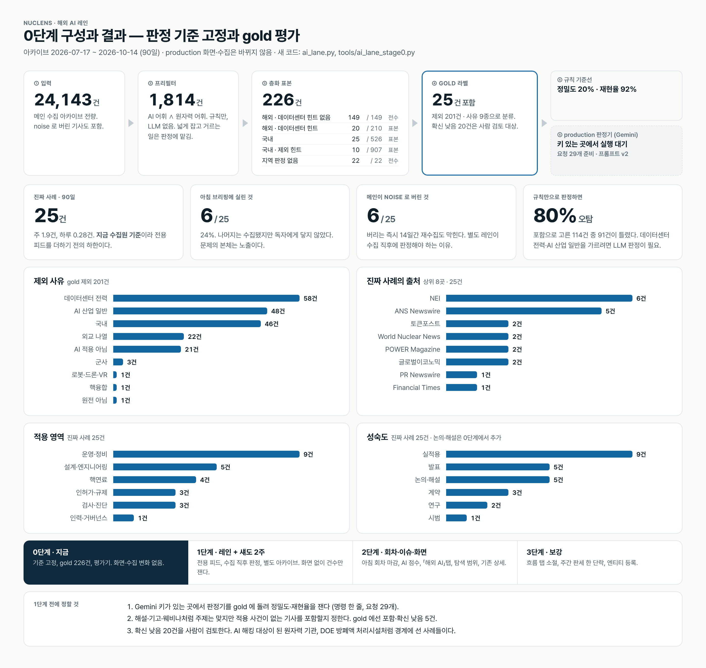
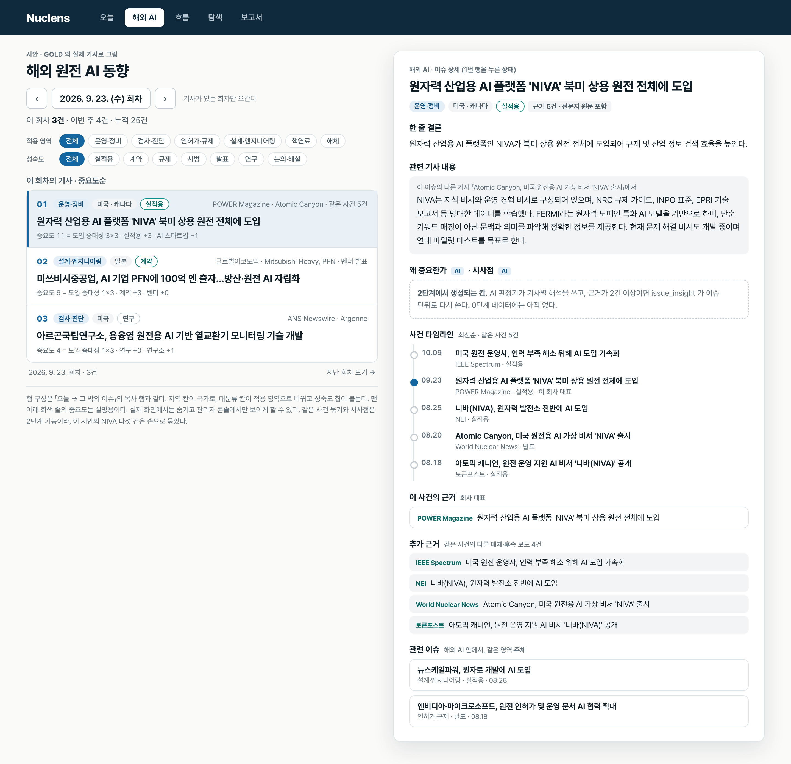

# 해외 AI 탭 — 방향성 검토 v4 (코드 변경 없음)

> 2026-10-14. 네 차례 검토의 결정을 반영하고, 마지막으로 **독립 재검토**(§7)를 더했다.
> v3 와 달라진 것: 화면이 연속 스크롤에서 **"오늘"과 같은 하루치 모드**로 바뀌었고(D3'),
> 그에 따라 **회차·중요도·빈 날** 세 가지를 새로 정했다(§4). 이전 판은 git 이력에 있다.

## 확정된 결정

| # | 결정 |
|---|---|
| D1 | 현재 뉴스 수집과 **별도 기준**으로 "해외 원전이 AI 를 활용했다"는 기사를 매일 뽑는다. 못 잡는 구조면 별도 구조. 중복은 현재 Nuclens 알고리즘대로. **별도의 AI 데이터베이스** |
| D2 | 수집원이 더 필요하면 추가 |
| **D3'** | 화면은 **"오늘 → 그 밖의 이슈"와 같은 구성**. 카드뉴스·스토리 제외. **그날 기사를 중요도순**으로. **날짜 이동은 기존 방식**(이전/다음·셀렉트). 연속 스크롤은 취소 |
| D4 | **해외만.** 국내 미고려 (해외 사례를 다룬 국내 매체 기사는 포함) |
| D5 | **순수 AI 기술**만. 로봇·드론·VR 자체는 제외하되, "AI 비전 판독 검사 로봇"처럼 AI 기술이 쓰인 경우는 포함 |
| D6 | 핵융합 제외 |
| D7 | 연구소 뉴스룸 기사 포함, 논문 자체 제외 |
| D8 | 탭 이름 **「해외 AI」** |
| D9 | **탐색 탭에서 "AI" 범위로 검색**되도록 별도 DB |
| D10 | 클릭하면 기존 이슈 상세 전체(한 줄 결론 · 기사 내용 · 시사점 · 타임라인 · 이 사건의 근거 · 추가 근거 · 관련 이슈) |
| D11 | 그 밖의 소소한 결정은 검토자가 정한다 → §5 |

---

## 0. 설계를 결정한 구조적 사실

1. 현재 파이프라인은 AI 활용 기사를 **수집은 하되 두 번 버린다.** 큐레이션 LLM 이 정책·투자 기준으로 `noise` 를 매기고(실측: NEI 「Tianwan puts AI to work」·「NIVA takes nuclear AI fleetwide」, POWER 「Predictive Digital Twins」), 즉시 `state["sent"]` 가 찍혀(`news_bot.py` 4095행) 14일간 재수집이 막힌다. noise 도 `archive/` 엔 남는다.
2. 그러므로 별도 기준은 **같은 크롤 프로세스 안, 수집 직후의 후보 풀**에 건다.
3. 이슈 상세(`openIssueDialog`)는 기사가 아니라 **이슈 레코드**를 읽는다: `summary`(한 줄 결론)·`detail`(기사 내용)·`implication`(시사점)·`why_important`·`open_question`·`related_articles`(card → 이 사건의 근거, evidence → 추가 근거, 날짜 정렬 → 타임라인)·`verification`·같은 주제의 다른 이슈. 이 레코드는 `cluster_selected_articles` → `attach_evidence_articles` → `build_issue_catalog` 가 만든다. **입력만 바꾸면 그대로 쓸 수 있다.**
4. "오늘"의 날짜 단위는 **아침 브리핑 회차**다(04:25 KST 전후 마감, `daily-brief.yml`). 날짜 이동(`briefingDates`·`stepBriefing`)은 회차가 있는 날만 오간다.
5. 메인 아카이브의 noise 레코드는 `title_kr`·`summary` 는 있지만 **`detail`·`implication`·`why_important` 가 빈 값**이다(실측). 공유 풀 기사도 AI 레인이 해석을 **다시 써야** 상세가 찬다.
6. 이 세션 환경은 news.google.com 에 닿지 못한다. 전용 피드 건수는 **Actions 러너에서** 잰다.

---

## 1. 전체 그림

```
   메인 레인 (변경 없음)                              AI 레인 (신설)
───────────────────────────────────    ────────────────────────────────────────────────────────
RSS·공식·Naver 수집 ─┐                   lane=ai 전용 피드 ─┐
                     ├─ 이번 run 신규 후보 풀 (전건) ─────┤
                     ▼                                     ▼
       큐레이션 LLM (정책 중요도)            [매 크롤, 3h]  AI 프리필터 → AI 판정+작성 LLM (전용 캐시)
                     ▼                                     → ai_archive/ + ai_state.json
       digest_queue → 아침 브리핑                          ▼
                     ▼                      [하루 1회, 아침 브리핑 회차에 맞춰]  AI 회차 마감
       archive/ (noise 포함)                  의미 그룹핑(같은 사건) → 대표 선정 → AI 중요도 점수 → ai_rounds.json
                     ▼                                     ▼
       build_data → issues.json              build_data (같은 함수) → ai_issues.json · ai_issue_ledger.json · ai_today.json
                                                           ▼
                                             웹: 「해외 AI」탭(하루치·중요도순·날짜 이동) · 탐색 "해외 AI" 범위 · 기존 상세
```

**별도 DB 네 층** (D1·D9):

| 층 | 메인 | AI 레인 |
|---|---|---|
| 기사 | `archive/YYYY-MM.jsonl` | `ai_archive/YYYY-MM.jsonl` (append-only·멱등) |
| 회차 | `delivery_log.jsonl`(브리핑 선정분) | `ai_rounds.json` — 날짜별 사건 목록·대표·점수·breakdown |
| 이슈 원장 | `issue_ledger.json` | `ai_issue_ledger.json` |
| 웹 산출 | `today.json`·`issues.json`·shards | `ai_today.json`·`ai_issues.json`·shards |

공유 풀 기사는 양쪽 아카이브에 다 남는다(이중 적재 허용, hash 로 조인). 메인 레코드는 고치지 않는다.

---

## 2. 수집·판정·중복 제거 (D1·D2·D4~D7) — v3 와 동일, 요약

- **입력 두 갈래**: 공유 풀(메인 신규 전건) + `lane: "ai"` 전용 피드(메인 큐 진입 금지, 게이트 = AI 어휘 ∧ 원자력 어휘, 테스트로 잠금).
- **전용 피드 후보**: Google News 검색(EN 일반·EN 사업자/벤더명·EN AI 벤더·JA·FR, `when:1d`), NRC·ONR·ASN·IAEA·OECD NEA, INL·ORNL·ANL·PNNL·EPRI 뉴스룸(D7: 논문 피드 없음), 사업자·벤더 뉴스룸, Atomic Canyon·Nuclearn·Blue Wave AI, JAIF·電気新聞·NIA·RGN. Naver 는 쓰지 않는다(D4). `feed_add` 섀도 등록은 **`lane` 속성 추가가 선행**.
- **포함**: 기계학습·예측정비 / 생성형 AI·LLM 문서 보조 / 컴퓨터 비전 판독(AI 판독 로봇 포함, D5) / ML 기반 디지털 트윈 / 규제기관의 AI 지침·심사 / 사업자 AI 거버넌스·인력.
- **제외 코드**: `datacenter_power`·`robotics_only`·`ai_industry_general`·`diplomatic_mention`·`domestic`·`fusion`·`academic_only`·`defense_weapons`. 경계: **AI 기술이 기사의 주어·목적어이거나 보도된 성과의 핵심 수단**.
- **판정+작성 한 호출**이 메인과 같은 필드(`title_kr`·`summary`·`detail`·`implication`·`why_important`·`open_question`·`topics`·`countries`·`event_date`…)를 만들고, 메인 헤드라인 규칙과 결정적 정리기를 그대로 거친다. 공유 풀 기사는 `title_kr` 만 재사용하고 **해석은 다시 쓴다**(§0-5). 고유 축: `ai_tech`·`application_area`·`actor_type`·`actor_names`·`maturity`·`adoption_significance`(§4-2).
- **중복 제거**: `url_hash` → `title_key` → `fold_cross_run_duplicates` → `dedup.py` 의미 그룹핑(회차 마감 때 1회) → 날짜 넘는 이슈 매칭(`cluster_selected_articles`·`attach_evidence_articles`). seen 은 `ai_state.json` 별도.
- **건수(추정, 섀도 2주로 대체)**: 원시 20~60 → 프리필터 10~30 → 판정 통과 1~4 → **중복 제거 후 사건 1~3/일**. Gemini 2~4 호출/일 + 그룹핑 1회. 메인 `QUOTA_EXHAUSTED` 면 AI 레인은 멈추고 다음 run 재시도(seen 마킹은 판정 뒤).

---

## 3. 이슈 묶기와 상세 (D10) — v3 와 동일, 요약

| 메인 | AI 레인 |
|---|---|
| 카드 멤버 = 브리핑 선정 기사 | **대표 기사** = 회차 마감의 의미 그룹핑이 사건마다 고른 1건(공식·전문지 우선) |
| 근거 멤버 = 뒤에 매칭된 미선정 보도 | 같은 사건의 다른 매체 + 날짜 넘어 매칭된 후속 보도 |
| `briefing_date` | **AI 회차 날짜** (§4-1) |

이후 `build_issue_catalog`·`issue_ledger`·`issue_insight`·`issue_headline` 전부 동일. 레인별 파일은 기존 경로 주입(`ISSUE_LEDGER_FILE` 류)에 들어간다. 웹은 상세가 이슈를 찾는 자리에 **레인별 조회 함수 하나**만 끼운다. "관련 이슈"는 AI 카탈로그 안에서 찾고, 같은 기사 hash 를 공유하는 메인 이슈가 있으면 "원전 이슈에서 보기" 1줄.

---

## 4. 화면 (D3'·D8) — 이번에 새로 정한 것

### 4-1. 회차 = 아침 브리핑 회차

- AI 레인의 "그날"은 달력 날짜도 발행일도 아니고 **아침 브리핑 회차와 같은 마감**이다. `daily-brief.yml` 의 Collect 뒤에 `AI 회차 마감` 스텝이 서서, 직전 마감 이후 판정 통과분을 한 회차로 묶는다.
- 이유: ① "오늘"과 날짜 축이 같아야 두 탭을 오가며 읽힌다. ② 3시간마다 회차를 갱신하면 하루 안에 같은 날짜 페이지의 내용이 바뀌어 날짜 이동과 충돌한다. ③ 의미 그룹핑·중요도 산정은 **그날 전체**를 놓고 한 번 하는 것이 정확하다(오전에 벤더 PR, 오후에 WNN 기사가 오면 한 사건이다).
- 판정 자체는 매 크롤에서 해 두므로(캐시) 아침 마감은 빠르다.
- 날짜 목록(`ai_today.json.dates`)은 **회차에 사건이 1건 이상인 날만** 싣는다. 이전/다음은 그 목록 안에서만 움직인다 — 빈 날을 넘겨 다니지 않는다.

### 4-2. 중요도 = AI 레인 전용 점수 (메인 importance 는 쓰지 않는다)

메인 `importance` 는 정책·투자 중요도라 이 기사들 대부분이 noise 다. 대신 **설명 가능한 결정적 점수**를 `ranking.py` 의 방식(LLM 은 feature 만, 점수는 Python, breakdown 기록)으로 둔다.

| 재료 | 출처 | 가중(초안, `ranking_config.json` 의 `ai` 절) |
|---|---|---|
| `adoption_significance` 0~3 | AI 판정 LLM. 3 = 함대 전체 실적용·규제 결정·최초 인허가 / 2 = 단일 호기 실적용·계약 / 1 = 시범·발표·MOU / 0 = 의견·전망·일반 | ×3 |
| `maturity` | deployed·regulatory·contract > pilot > announced > research | +3 / +2 / +1 / 0 |
| `actor_type` | utility·regulator·international_org > national_lab > vendor > ai_startup | +2 / +1 / 0 / −1 |
| 근거 구성 | 공식 원문·독립 출처 수(`verification`) | 출처당 +1, 상한 +3 |
| 매체 등급 | `source_tier` | tier1 +1 |
| 동률 | 발행 시각 최신 | — |

같은 날 1~3건이면 순서가 큰 의미는 없지만, 양이 늘었을 때 그대로 쓰이고 breakdown 이 `ai_rounds.json` 에 남아 "왜 위인가"를 설명한다.

### 4-3. 구성

- 탭 순서 `오늘 · 해외 AI · 흐름 · 탐색 · 보고서`. 상단 `main-tabs` + 하단 `mobileTabs` 둘 다. `longterm` 과 같은 `hidden` + 데이터 게이트(누적 20건)로 연다.
- "오늘"에서 **쓰는 것**: 머리(제목·날짜 이동·한 줄 안내), 목차 패널(`briefPanel`·`tocRow`), 상세. **빼는 것**: 카드뉴스·오디오·먼저 볼 3건·한 주의 원자력·푸시 버튼.
- 행 = `tocRow` 그대로. 지역 칸 → **국가**, 대분류 칸 → **적용영역**, 꼬리에 **성숙도** 칩. 벤더·AI 스타트업 발표는 "벤더 발표" 라벨을 달아 독자가 가중을 낮출 수 있게 한다. 요약은 행에 안 쓴다.
- 한 줄 안내: "이 회차 N건 · 이번 주 N건 · 누적 N건".
- **빈 회차 폴백**: 날짜 목록에 빈 날이 없으므로 보통은 생기지 않지만, **가장 최근 회차가 오늘이 아닐 때** 머리에 "오늘 신규 없음 · 최근 회차 MM-DD" 한 줄을 띄우고 그 회차를 보여준다. 빈 화면·죽은 버튼은 두지 않는다(index.html 의 원칙).
- 산출물: `ai_today.json`(최신 회차 + dates — today.json 과 같은 모양), `ai_issues.json`, `ai_news-manifest.json`+shards, `meta.ai{total, rounds, last_round}`. 이미 지은 레코드에서 **잘라 담기만**.

### 4-4. 탐색 탭 "해외 AI" 범위 (D9)

`archiveScope` 세그먼트에 `해외 AI` 추가(`as=ai`). 조회 대상만 `ai_issues.json` 으로 바뀌고 기간·주제·근거 구성·검색어·정렬·`archiveIssueMatches` 는 그대로. 지역 필터는 `해외` 고정(숨김). 주제 셀렉트에 적용영역 8종을 추가 노출.

---

## 5. 소소한 결정 (D11 — 검토자가 정함)

| 항목 | 결정 | 이유 |
|---|---|---|
| 적용영역 라벨 | 운영·정비 / 검사·진단 / 인허가·규제 / 설계·엔지니어링 / 핵연료 / 해체 / 안전조치·보안 / 인력·거버넌스 (8) | 한수원 부서 구분과 가깝고 칩 한 줄에 들어간다 |
| 성숙도 라벨 | 연구 / 시범 / 발표 / 계약 / 실적용 / 규제 (6) | 점수 가중과 1:1 |
| 탭 노출 게이트 | 누적 사건 20건 | 2~3주 분량. 그 전엔 "탭을 열었는데 몇 줄"이 된다 |
| 관련 이슈 교차 링크 | 같은 기사 hash 를 공유할 때만 1줄 | 제목 유사도로 잇지 않는다(이 저장소의 오병합 교훈) |
| 사람 교정 경로 | `admin_overrides` 에 `ai_include`·`ai_exclude` kind 를 **1단계부터** | D5 경계는 판정이 틀릴 자리다. 교정 경로가 없으면 틀린 것이 DB 에 굳는다 |
| 검수 큐 | 이슈 매칭 검수 후보(`review_candidates`)는 레인별로 분리 | 메인 콘솔 큐에 AI 후보가 섞이면 운영자가 두 기준으로 판단해야 한다 |
| 발송 | 텔레그램·푸시 없음 | 요청에 없음. 데이터가 쌓인 뒤 결정 |
| 근거 배지 | 레인별로 기준을 낮추지 않는다 | 단일 출처·벤더 PR 이 많은 것은 사실이고 그게 보여야 한다 |

---

## 6. 단계안

| 단계 | 내용 | 코드 | 판단 |
|---|---|---|---|
| **0. 기준 고정 + gold** | 아카이브 3개월 후보 ~300건에서 손라벨 50~80건(in/out·exclude_reason·D5 경계). 판정 프롬프트 초안 평가 | 로컬 스크립트 | 정밀도·재현율 |
| **1. 레인 + 섀도** | `lane` 소스 속성, 프리필터·판정·작성 모듈, `ai_archive/`·`ai_state.json`·`ai_judgments.json`, 전용 피드, 소급 1회, `ai_include/exclude`. **화면 없음.** 운영 요약 한 줄 | 있음 | **2주 관측** — 사건/일, 벤더 비중, 오병합률 |
| **2. 회차 + 이슈 + 화면** | 회차 마감 스텝·AI 점수, 같은 함수로 `ai_issues.json`·원장, 「해외 AI」탭, 상세 레인화, 탐색 범위 | 있음 | 누적 20건 자동 노출 |
| **3. 보강** | 흐름 탭 "해외 AI" 소절, 주간 판세 한 단락, 엔티티 등록, 월별 shard | 선택 | §7 |

---

## 7. 독립 재검토 — 다르게 보는 것과 개선 제안

요청대로 지금까지의 방향(사용자 결정 포함)을 전제 없이 다시 봤다. 결론부터: **큰 틀(별도 레인·별도 DB·이슈 계약 재사용·해외·순수 AI)은 맞다.** 아래는 바꾸거나 더하면 좋겠다고 보는 것이다. 각각 이유와 비용을 적었다.

### 7-1. 하루치 모드의 대가 — 그래도 하루치가 맞지만, 두 가지를 같이 가져가야 한다

하루 1~3건, 0건인 날이 많은 흐름에 하루치 모드를 쓰면 "오늘 들어가면 두 줄"이 일상이 된다. 연속 스크롤이 이 문제엔 더 자연스러웠다. 그럼에도 하루치를 지지하는 이유는 ① "오늘"과 같은 읽기 습관, ② 회차 단위 중복 제거·중요도가 정확해진다는 것이다. 대신 **(a) 날짜 목록은 사건이 있는 날만**, **(b) 최근 회차가 오늘이 아니면 그 사실을 한 줄로 말하고 그 회차를 보여준다** — 이 둘이 없으면 하루치 모드는 빈 화면 모드가 된다. 양이 늘면(일 5건+) 이 걱정은 사라진다.

### 7-2. "그날"은 달력 날짜가 아니라 아침 브리핑 회차여야 한다 (§4-1)

사용자 결정은 "날짜 변경 시 그 날짜 내용"인데, 그 날짜의 정의를 정하지 않으면 3시간마다 바뀌는 페이지가 된다. 아침 회차에 맞추면 "오늘"과 축이 같고, 그룹핑·점수를 하루 한 번만 하면 된다. 비용은 **최대 하루 지연**(오후 기사가 다음 날 아침 회차에 실림)이다. 메인 브리핑도 같은 지연을 받아들이고 있다.

### 7-3. 중요도는 메인 것을 빌리지 말 것 (§4-2)

메인 `importance` 는 이 기사들에 대해 noise 를 매긴 바로 그 축이다. 전용 점수가 필요하고, 그것도 LLM 에게 "중요도"를 직접 묻지 말고 `ranking.py` 처럼 feature 하나(`adoption_significance`)만 받아 Python 이 점수를 매기는 편이 설명 가능하다.

### 7-4. 공유 풀 재사용은 제목까지만 — 해석은 다시 써야 한다 (§0-5)

v2·v3 는 "메인 큐레이션 결과가 있으면 재사용해 호출을 아낀다"고 했는데, noise 레코드는 `detail`·`implication`·`why_important` 가 비어 있다. 상세의 기사 내용·시사점이 비게 된다. **정정**: `title_kr` 만 재사용, 나머지는 AI 레인이 쓴다. 호출 수는 어차피 하루 몇 회다.

### 7-5. 이슈 묶기 기계를 통째로 태우는 것은 과한가 — 아니다, 단 검수 큐는 가르라

하루 1~3건에 임베딩·사건 정체성·검수 큐까지 도는 것은 과해 보인다. 그러나 대안(사건당 1 이슈를 손으로 만들기)은 날짜를 넘는 타임라인(같은 벤더 제품의 2호기·3호기 적용, 규제 지침 초안→확정)을 잃고, 상세의 "추가 근거"가 영영 비게 된다. 함수가 입력 주입을 이미 받으므로 비용은 작다. 유일한 부작용은 **관리자 검수 큐에 AI 후보가 섞이는 것**이라 레인별로 가른다(§5).

### 7-6. 측정 없이 화면을 짓지 말 것 — 1단계 섀도 2주는 생략 불가

모든 건수가 추정이다. 전용 Google News 질의가 하루 60건을 돌려주는지 6건인지, 그중 벤더 PR 이 7할인지 3할인지에 따라 점수 가중·게이트·칩 구성이 달라진다. 화면(2단계)을 먼저 지으면 두 번 짓게 된다.

### 7-7. 더하면 좋은 것 (3단계, 저비용)

- **흐름 탭에 "해외 AI" 소절**: 적용영역·국가·성숙도별 주간 건수. 데이터가 이미 통제 태그라 `trend.json` 집계에 한 묶음 더하는 수준. 이 탭의 존재 이유("동향")에 가장 직접적이다.
- **주간 판세에 "해외 AI 한 주" 한 단락**: 사용자의 업무가 동향 보고라면 매일 보는 탭보다 금요일 한 단락이 더 쓰일 수 있다. `weekly_bot` 에 섹션 하나.
- **국내 비교는 스위치 하나로 켤 수 있게 설계해 둔다**: 판정이 `country` 를 내고 `domestic` 은 제외 사유로 캐시에 남으므로, 나중에 "한수원 AI 사례를 참고로"가 필요해지면 DB 재구축 없이 필터만 바꾸면 된다. 지금은 D4 대로 끈다 — 결정을 바꾸자는 게 아니라 되돌릴 수 있게 짓자는 것이다.

### 7-8. 바꾸지 않아도 된다고 본 것

- 탭 이름 「해외 AI」· 위치(오늘 바로 뒤) — 좋다.
- 순수 AI 범위(D5~D7) — 좁은 정의가 초기 정밀도를 지킨다. 넓히는 것은 나중에 싸고, 좁히는 것은 비싸다.
- 별도 파일 DB — 같은 아카이브에 레인 필드를 넣는 대안은 append-only JSONL 에 뒤늦게 필드를 더하는 것이라 성립하지 않는다.

---

## 8. 0단계 결과 (2026-10-14 구현)



새 코드는 셋이다. production 수집·화면은 바뀌지 않았다.

- `ai_lane.py` — 프리필터(AI 어휘 ∧ 원자력 어휘), 제외 힌트, 판정 프롬프트·요청 생성기·응답 정규화.
  1단계 production 이 그대로 쓸 모듈이다. `llm_policy` 에 `ai_lane_judge` 프로필을 등록했다.
- `tools/ai_lane_stage0.py` — 후보 추출 · 층화 표본 · 규칙 기준선 · production 판정기 실행 · 평가.
  평가기는 판정 프롬프트를 갖지 않고 `ai_lane.build_request` 를 그대로 쓴다.
- `eval_artifacts/ai_lane/` — 후보·표본·**gold 226건**·평가 결과. 상세는 그 디렉터리의 README.

| 항목 | 값 |
|---|---|
| 90일 진짜 사례 | 25건 — 주 1.9건 (지금 수집원 기준 하한) |
| 메인이 noise 로 버린 것 | 6 / 25 |
| 아침 브리핑에 실린 것 | 6 / 25 |
| 규칙 기준선 | 정밀도 20% · 재현율 92% |
| production 판정기 | 미측정 (Gemini 키 필요, 요청 29개 준비) |

**§0-1 정정.** "대부분 noise" 는 과장이었다. 실측은 noise 24%, 나머지 76% 는 nice_to_know·must_read 로
남았다. 다만 브리핑에 실린 것은 24% 뿐이라, 문제의 본체는 **수집이 아니라 노출**이다. 별도 레인·별도 탭의
필요는 그대로다.

**출처 집중.** 진짜 25건 중 11건이 NEI(6)·ANS Newswire(5)에서 왔다. 1단계 전용 피드의 1순위는
이 두 매체의 AI 섹션·태그 피드, 그다음이 §2-2 의 검색 피드다.

### 「해외 AI」탭 시안 (gold 의 실제 기사로 그림)



2026-09-23 회차의 진짜 사례 3건을 §4-2 점수로 정렬했다. 1번 행의 NIVA 기사는 8/18~10/9 다섯 매체 보도가
이어져 타임라인·추가 근거가 실제 데이터로 찬다. 같은 사건 묶기와 시사점은 2단계 기능이라 시안에서는
손으로 묶었고 시사점 칸은 비워 두었다.

### 1단계 전에 정할 것

1. Gemini 키가 있는 곳에서 `python tools/ai_lane_stage0.py judge` 로 판정기를 gold 에 돌린다.
2. 해설·기고·웨비나(성숙도 `discussion`)를 탭에 넣을지 정한다.
3. gold 의 확신 낮음 20건을 사람이 검토한다.

## 9. 구현 결정 (2026-10-14, 0단계 결과를 본 뒤)

| 항목 | 결정 |
|---|---|
| 판정기 정밀도 측정 | 생략. 실제 운영하며 고친다 |
| 해설·기고·웨비나 | **포함** (성숙도 `discussion`, 도입 중대성 0) |
| gold 경계 20건 | 검토 확정. 포함 8(해설 5·방폐액 처리시설·미쓰비시 출자·웨스팅하우스 시연) · 제외 12 |
| 섀도 모드 | **쓰지 않는다.** 1단계 레인을 바로 운영에 넣고 화면까지 이어 붙인다 |
| 오늘자 | 2단계 배포 때 오늘 회차를 수동으로 백필해 화면 분위기를 본다 |

1단계 구현: `ai_lane_pipeline.py` 가 news_bot 의 메인 아카이브 적재 직후에 돈다. 입력은 최근 3일 메인
아카이브(공유 풀) + 전용 Google News 피드 7개. 판정 통과 기사는 `ai_archive/YYYY-MM.jsonl`, 판정 이력은
`ai_state.json`. 판정 실패는 표식 없이 다음 회차가 다시 묻고, 세 번 실패하면 포기한다.

## 10. 2단계 구현 (2026-10-14)

| 조각 | 파일 | 내용 |
|---|---|---|
| 회차·사건·점수 | `ai_lane_web.py` | 회차 = 메인 수집일(KST, `collected_at`). 같은 사건 = 제목 같음, 또는 주체 겹침 ∧ 적용 영역 같음 ∧ 30일 안. 회차 안 순서 = 도입 중대성×3 + 성숙도 + 주체 + 근거 구성 |
| 빌드 | `web/build_data.py` | `ai_issues.json` 출력. 근거 배지는 메인 `verification_state` 를 그대로 쓴다. 실패해도 빌드는 계속(빈 탭) |
| 탭 | `web/public/index.html`·`app.js`·`style.css` | 「해외 AI」 상단·하단 탭(데이터 없으면 숨김). 「그 밖의 이슈」 목차 행, 이전/다음·셀렉트 회차 이동, 적용 영역·성숙도 칩, 최근 회차가 오늘이 아니면 안내 한 줄 |
| 상세 | `app.js` | 기존 이슈 대화상자. `ai-` 접두 id 로 AI 카탈로그를 찾는다. 문구만 "회차 대표"·"이 회차"로 바꾸고 성숙도·AI 기술·주체·벤더 발표 표시를 더한다 |
| 탐색 | `app.js`·`index.html` | 범위 버튼 「해외 AI」(`as=ai`). 기간·주제·근거 구성·검색어 필터가 그대로 동작. 빠른 검색에도 AI 이슈가 걸린다 |
| 주소 | `app.js` | AI 이슈는 `/issue/<id>/` 정적 페이지가 없으므로 `?issue=ai-…` 로 남긴다(새로고침 404 방지). 회차는 `?view=ai&aid=날짜` |
| 백필 | `tools/ai_lane_backfill.py`·`eval_artifacts/ai_lane/seed_manual.json` | 아래 참고 |

**백필 범위.** 요청은 "오늘자만"이었다. 오늘(10-14) 회차는 공유 풀(메인 아카이브 오늘분에서 프리필터 통과 13건 — 국내·데이터센터 전력·AI 규제뿐)과 웹 검색 모두 해당 기사가 **0건**이었다. 빈 탭으로는 분위기를 볼 수 없어서, 0단계에서 검토를 마친 진짜 사례 25건을 원래 수집 날짜의 회차로 함께 넣었다(판정자 `manual-claude`, 해석 문장은 사람이 씀). 그래서 첫 화면은 "오늘 새로 잡힌 기사 없음 · 최근 회차(10-10)"로 열린다. 다음 크롤부터는 레인이 최근 3일 공유 풀과 전용 피드를 자동으로 판정해 이어서 쌓는다.

**첫 실전 회차(2026-10-14 09:53 UTC, crawl #669).** 풀 1,255건(최근 3일 공유 풀 + 전용 피드) → 프리필터 통과 92 → 판정 48(회차 상한) → 포함 1 · 제외 47(데이터센터 전력 21 · 국내 17 · AI 적용 아님 6 · AI 산업 일반 3) · 실패 0 · 다음 회차로 44. 포함 1건은 「현대차·HD현대, AI 자율운항 선박·SMR 추진 선박 협력」이라 **오판**이었다. 메인이 국내(`kr`)로 본 기사는 판정과 무관하게 제외하는 결정적 규칙(`domestic_guard`, 화면 빌드에도 같은 규칙)을 넣고, 그 레코드는 DB 에서 뺐다. 프롬프트에 "한국 기업이 주체면 국내", "원전 밖 AI 는 원전 아님" 예시를 더했다(v5).
